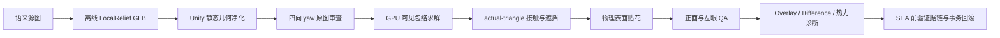

# Garden Cottage V76：风格实现机制详细技术版

> 精简结论版：`/Volumes/APFS/Unity/Projects/PersonallyPuzzledVR/Docs/GARDEN_COTTAGE_V76_STYLE_IMPLEMENTATION_20260827.md`

## 0. 文档定位

这份文档解释 V76 最终结果是**怎么被构造、装进 Unity、求解位置并被验证**的，粒度足够定位实现、复跑流程和替换资产。

它不把结构通过等同于风格统一。最终 Part_06 / Part_07 仍有明显浅浮雕与贴片感；自动验证和当前记录中的 `Codex independent original-resolution Unity review` 为 `PASS`。该 reviewer 字段不是用户签字，也不是独立人类美术总监认证；正式用户验收仍为 `PENDING`。

最终权威验收链不依赖 Three.js 或浏览器渲染。Python 只负责离线生成确定性 GLB；场景、材质、构图、接触、遮挡、双眼画面和最终证据全部以 Unity 为准。检查点内保留过一张历史非权威查看器 QA 图 `/Volumes/APFS/Unity/Projects/PersonallyPuzzledVR/Artifacts/Checkpoints/169_GardenCottage_V76_ProviderSemanticReplacement_20260824/GardenCottage_V76_LOCAL_RELIEF_THREEJS_QA.png`，它没有进入最终 PASS 证据链。

## 1. 最终架构



核心设计不是让单个模型“一次生成就正确”，而是把问题拆成五层：

1. 源图层只解决语义和内部比例。
2. 几何层只解决可重复的三角网格、轮廓、厚度和侧壁。
3. Unity 求解层只解决正确朝向、屏幕构图和物理装配。
4. 视觉层只解决双眼、白边、接缝、贴花和遮挡稳定性。
5. 证据层保证场景、截图、矩阵和报告来自同一迭代。

## 2. 版本边界与最终改动面

- 冻结回滚点：`/Volumes/APFS/Unity/Projects/PersonallyPuzzledVR/Assets/Scenes/GardenCottage_20260824_V01_SemanticDetailCorrection.unity`
- 独立 V76 场景：`/Volumes/APFS/Unity/Projects/PersonallyPuzzledVR/Assets/Scenes/GardenCottage_20260824_V02_ProviderSemanticReplacement.unity`
- V76 只替换/增补 Part_06、Part_07、Part_07 牌面贴花和 Part_01 工作台支撑扩展；既有房屋、树、工作台源模型保持冻结。
- Part_06 / Part_07 最终没有采用 Meshy 或 Tripo 输出，而是采用离线确定性 LocalRelief GLB；因此最终场景不依赖远端任务状态，也不需要持久化任何 API key。历史 Meshy 尝试只记录为 `UNKNOWN_COMMIT`、空 task receipt，不能据此断言远端绝对没有提交任务；能断言的是没有远端产物进入最终链。
- Part_08 的源 GLB、旋转和统一缩放保持冻结，只允许平移；Part_01 provider 根变换与源 GLB 字节保持冻结。
- 场景和视觉资产没有在本文档工作中再次修改；本文只记录已完成实现。

## 3. 输入、产物与不可变身份

| 对象 | 最终输入/产物 | SHA-256 / 身份要点 |
|---|---|---|
| Part_06 源图 | `/Volumes/APFS/Unity/Projects/PersonallyPuzzledVR/Assets/GardenCottage/V76/PartSources/GardenCottage_Part_06_CurvedFloweringVine_SourceEnvelope_V76_R03_CompactWallRelief.png` | `ae1d7acffdd978088714e3593b39032e6f982d38e35f8f7a307c5ac5bcfd4417` |
| Part_06 GLB | `/Volumes/APFS/Unity/Projects/PersonallyPuzzledVR/Assets/GardenCottage/V76/Parts3D/DerivedLocalRelief/GardenCottage_Part_06_CurvedFloweringVine_V76_LocalReliefFallback_Hero.glb` | `cedfca071e44e0f2712b4f8579d154a3c82c25404ce0234d6682e6f004a3d512` |
| Part_07 源图 | `/Volumes/APFS/Unity/Projects/PersonallyPuzzledVR/Assets/GardenCottage/V76/PartSources/GardenCottage_Part_07_SignFenceFlowerbed_SourceEnvelope_V76_R05_XCompressed.png` | `715fb897c5fc4e79a7da1950a16851b178f4e3478fd0217261add1355f8def85` |
| Part_07 GLB | `/Volumes/APFS/Unity/Projects/PersonallyPuzzledVR/Assets/GardenCottage/V76/Parts3D/DerivedLocalRelief/GardenCottage_Part_07_SignFenceFlowerbed_V76_LocalReliefFallback_Hero.glb` | `7cfc9ed7651875812f96f0fefb374408d601d89f50104745daedbaae91d7fcda` |
| V76 变换矩阵 | `/Volumes/APFS/Unity/Projects/PersonallyPuzzledVR/Assets/GardenCottage/V76/GardenCottage_V76_ProviderSemanticReplacementMatrices.json` | `8e3528ea5365724c15c60ec30fcf8ef6029c0cd9667e1fcfedfe90e4e92ea742` |
| 最终场景 | `/Volumes/APFS/Unity/Projects/PersonallyPuzzledVR/Assets/Scenes/GardenCottage_20260824_V02_ProviderSemanticReplacement.unity` | `3c041a638f5ac54867630871ef4912fcdd37537d795613e47dab21e5e151fdca` |

源图先于建模被验收，因为 Unity 的 T×R×S 只能改外部姿态，不能修复错误的内部语义。Part_06 必须没有树桩、根脚或落地主体；Part_07 必须保留“左木柱—吊牌—蓝栅栏—花床”的顺序、负空间和蓝色跨度。

## 4. LocalRelief：二维源图怎样变成真实三角 GLB

基础生成器：`/Volumes/APFS/Unity/Projects/PersonallyPuzzledVR/Tools/AI3D/build_garden_cottage_v76_local_relief_fallback.py`

### 4.1 前景分割

1. 从画布边界像素估计背景 RGB 中位数，而不是假定纯白。
2. 对每个像素计算它与背景色的 RGB 欧氏距离，得到前景置信分数。
3. 对“整体变暗但三通道接近”的中性阴影降权：平均差小于 `-4`、通道差幅小于 `10` 时，置信度乘 `0.25`。这样纸面投影不容易被误生成为实体。
4. 把分数图缩到长边 `320` 的规则网格；阈值为 `18`。
5. 进行一次形态学闭运算，保留最大的 8 连通分量，再闭运算一次，去除孤点并补小孔。
6. 用前景分数的第 95 百分位归一化浮雕强度；alpha 使用 Lanczos 放大的二值 mask，RGB 保持原始源图像素。

这一步故意把“颜色”和“是否有几何”分开：RGB 负责外观，mask 负责拓扑。

### 4.2 网格构造

- 网格 X/Y 按源图比例归一化，Y 高固定为 `1`，X 居中。
- 前表面深度：`z_front = depth × (0.15 + 0.35 × relief)`。
- 后表面深度：`z_back = -0.5 × depth`。
- 每个前景 cell 生成前面和背面的 indexed triangles。
- 暴露的 cell 边界生成侧壁 quad，因此结果不是 billboard，也不是只含一个正面平面。
- 侧壁 UV 不直接采样透明边缘，而是在半径 `3` 内寻找置信度最高的前景像素，并用 `0.025 × 距离` 作惩罚；这一步专门抑制白色 matte 和“白梳齿”。
- 基础生成器验证索引范围、所有顶点均被引用、GLB 结构和最低边界顶点数量；逐三角面积的非退化硬门由 Part_06 V04 的专用生成器额外执行，不能泛化到 Part_07。

### 4.3 GLB 材质

- 内嵌源图 RGBA PNG，避免外部纹理丢失。
- `alphaMode = MASK`，`alphaCutoff = 0.20`，不是半透明混合。
- `metallic = 0`，`roughness = 0.78`，启用 trilinear mip sampler。
- `doubleSided = false`，真实背面和侧壁负责侧视表现。

这也解释了风格上限：GLB 只有源图 BaseColor/Alpha 与固定材质标量，没有与旧资产同源的独立 Normal、Metallic-Roughness 纹理。

## 5. Part_06：藤蔓的专用轮廓修正

最终生成器：`/Volumes/APFS/Unity/Projects/PersonallyPuzzledVR/Tools/AI3D/build_garden_cottage_v76_part06_smoothed_relief_v04.py`

V04 不编辑一份既有 V03 GLB，而是先校验 `V03 → V02 → 基础生成器` 的代码 SHA，再从同一源图确定性重建：

- 生成器首先验证 V03 代码 SHA，避免基础算法被无声改写。
- 对边界执行一次 Laplacian 平滑，`λ = 0.25`；允许上限为 `0.35 cell`，实际最大位移为 `0.1767767 cell`。
- 518 个边界角点被移动，对应 3,108 个前/后/侧顶点；966 个侧壁 quad 重新定向。
- 源图像素、UV、alpha 和既定生成拓扑规则保持不变；输出后再次检查 cutout 字节未变化，并要求最小三角形 twice-area `> 1e-10`，最终最小值为 `5.784585×10^-6`。
- 仅把深高比从 V03 调到最终 `0.0131`，压低双眼侧缘，而不通过非均匀缩放伪造弯曲。

最终网格：21,492 顶点、35,252 三角形、30 个最低 `y=0` 索引顶点；这些顶点对 Part_06 只是几何统计，不代表接地语义。源图 `887×1774`，生成网格 `160×320`。

## 6. Part_07：复合语义与有机最低边界

Part_07 使用 `Part07OrganicContactReliefV01` 配方，保持牌子、栅栏和花床为一个连接根：

- 47,674 顶点、84,596 三角形。
- 源图 `1024×1536`，网格 `213×320`。
- 20,476 个前景 cell、1,346 条轮廓边。
- 归一化深高比为 `0.08`，不是 `0.08 m`；`contact_band_ratio=0.0`，没有人为压平的底带。真实有机轮廓上有 120 个 `y=0` 已索引顶点，最低要求为 48。
- 没有拆成多个可随意移动的子物体，防止 Unity 装配破坏内部顺序与负空间。

GPU 外包络通过后，还要额外满足：蓝栅栏水平跨度至少 `0.60`、独立栅条之间存在负空间、第一根蓝栅条在木柱的正确一侧、底部不能出现横跨全宽的实心 slab。

## 7. Unity 导入与静态几何不变量

权威 Builder：`/Volumes/APFS/Unity/Projects/PersonallyPuzzledVR/Assets/Editor/GardenCottageHouseCoreV06Builder.cs`

导入使用 glTFast `ForceSynchronousImport`。实例化前先核对 metadata、生成器 SHA、源图 SHA、GLB SHA 和两个彼此独立的 build ID；之后把 V76 provider 实例净化为严格静态结构：

- 允许 `Transform + MeshFilter + MeshRenderer`。
- 拒绝 Camera、Light、Audio、Animator、Playable、Particle、LOD、Physics、残留脚本和 missing script。
- 要求可读、非退化、indexed triangle mesh。
- material slot 数必须和 submesh 数一致。
- 一个语义资产只允许一个根，最终缩放必须统一；禁止靠非均匀缩放改形。

初始 seed 不是凭 Renderer AABB 任意缩放，而是：

`scale = 0.985 × retiredEnvelope.height / rotatedProviderHeight`

也就是只按旋转后真实三角顶点高度给一个略留余量的统一缩放。Part_07 随后对齐其最低实际支撑；Part_06 随后贴回 actual-triangle 墙面坐标。

最终画面完全由 Unity URP 解释；外部 GLB 预览器的坐标、alpha、灯光或材质观感不作为验收证据。

## 8. 四向 yaw：先证明哪一面是正面

Unity 对 Part_06、Part_07 分别渲染 `0° / 90° / 180° / 270°` 的原分辨率隔离图。

选择文件：`/Volumes/APFS/Unity/Projects/PersonallyPuzzledVR/Assets/GardenCottage/V76/GardenCottage_V76_ProviderYawSelection.json`

最终两件都选 `180°`：

- `0°` 是镜像背向。
- `90° / 270°` 暴露侧缘，不能表达源图语义。
- `180°` 保持未镜像的木柱/牌子/栅栏关系和藤蔓朝向。

选择记录同时绑定 GLB SHA、被选截图 SHA、状态 `PASS` 和原分辨率审查理由；不是只把角度写进代码。

## 9. GPU 可见包络求解：不用 Renderer AABB 猜构图

求解时把目标资产渲染成洋红隔离 mask，从 Unity 最终像素中读取真实 silhouette。两件资产共享测量方式，但求解策略不同：

1. 先测量当前可见矩形和中心。
2. Part_06 把目标宽高的 `±15%` 门转换成统一缩放可行区间；宽、高区间必须相交。候选比例取调和均值，更新阻尼为 `0.5`，单轮倍率限于 `0.65..1.45`。
3. Part_07 的复合求解 helper 要求宽高比例意见 `aspectAgreement <= 1.25`，采用几何均值更新，并在每次尺寸/中心变化后把有机最低边界重新贴回 actual Part_01 接触面。
4. 两者的中心移动都不是射线猜测，而是 `SolveImagePlaneDelta`：分别沿两个 Unity 相机像平面世界轴扰动 `0.025 m`，测出屏幕有限差分 Jacobian，再反解所需世界位移。
5. 每轮都由 Unity GPU 重渲染、重测；actual-triangle 射线只用于后续墙面、接触、遮挡和所有权验证。
6. 每个资产只保留一个统一 T×R×S 解，禁止拆子件或非均匀拉伸。

必须区分“最终解是怎样得到的”和“当前公开入口现在做什么”：当前 `ApplyV76ReviewedProviderYawsAndSolveCore` 已冻结并验证提交到场景/矩阵文件中的 Part_07 T×R×S，不再调用 `SolveV76CompoundVisibleEnvelopeWithFoundationContact` 从 seed 重求 Part_07。因此现有入口是对已提交 V76 的复验/重放，不是从干净 V75 Audit Seed 自动恢复最终 Part_07 的完整重建器。

最终包络：

- Part_06：`(1020,335,147×600)`，中心误差 `0 px`。
- Part_07：`(80,621,410×624)`，中心误差 `10.74 px`。

最终冻结矩阵：

- Part_06：T=`(0.7567715,-0.0256125,-0.7505476)`，yaw=`180°`，统一 scale=`1.6334895`。
- Part_07：T=`(-1.6193657,-0.1953497,-1.1007743)`，yaw=`180°`，统一 scale=`1.3344547`。

包络只证明屏幕构图正确，不证明内部纹理、风格或物理接触正确，所以后面仍有 actual-triangle 门。

## 10. Part_06：实际墙面装配与双眼遮挡

历史藤蔓的背面离真实墙面约 `0.923 m`，单看截图会误以为已经贴墙。V76 改用实际 Part_02 三角面：

1. 在固定墙面 ROI 上发射 `5×5` 屏幕射线。
2. 以法线方向、行列覆盖、坐标中位数、MAD、平面残差和法线角筛掉窗框/屋檐等污染命中。
3. 最终 25 个命中中接受 23 个；坐标 MAD `0.5 mm`，p90 残差 `3.2 mm`，p90 法线角 `5.0932°`。
4. 确定墙面侧坐标后，Part_06 只沿墙面切线和世界 Y 移动；背面重新贴到墙面并保留版本化 clearance。
5. 正面和 32 mm 左眼分别重算间隙、所有权、blocker 和四个屋顶负探针。

最终硬门：

- 世界厚度约 `0.0214 m`，世界高度约 `1.6335 m`，比例 `0.0131`。
- 正面/左眼 blocker ratio 为 `0.0070 / 0.0056`。
- 载体覆盖率约 `0.2578 / 0.2523`。
- 屋顶负探针双眼 `4/4` 仍由 Part_02 所有，没有被藤蔓吞掉。

对应阈值不是只看这四个最终数：墙面 ROI 至少接受 6 点并跨至少 3 行/3 列，坐标 MAD `<=6 mm`、p90 平面残差 `<=12 mm`、p90 法线角 `<=15°`；世界厚度必须在 `18..45 mm`、深高比在 `0.012..0.030`、背面间隙在 `-0.5..8 mm`。每眼还要求 body cells `>=100`、attachment hits `>=60`、coverage `>=0.15`、median gap `2..15 mm`、p90 gap `<=25 mm`、blocker `<=0.02`、固定正探针至少 `6/7`、屋顶负探针 `4/4`。

权威报告：`/Volumes/APFS/Unity/Projects/PersonallyPuzzledVR/Artifacts/Checkpoints/169_GardenCottage_V76_ProviderSemanticReplacement_20260824/GardenCottage_V76_TreeRoofAndVineFacadeOcclusionAudit.md`

## 11. Part_07：actual-triangle 接地

Part_07 的最低带样本向 Part_01 的真实三角形求有符号 Y 间隙，不使用无限平面或隐藏 collider：

- 最终审计使用 15 个最低边界样本。
- 实际三角命中率 `0.800`。
- 合法接触率 `0.800`。
- gap 范围 `-0.005..+0.024 m`。
- 所有调整作用于复合根的统一变换，牌子、栅栏和花床不会彼此漂移。

硬门要求 hit/contact 均 `>=0.80`、支撑法线 `y>=0.50`、gap 在 `[-8,+25] mm`。`80%` 表示严格采样覆盖通过，不代表每个顶点都焊接在地基上；它证明规定采样的可见底带有足够真实支撑。

## 12. 牌面为什么是“物理贴花”而不是 UI

牌面需要保留参考图的可读文字/图案，但不能用屏幕 UI 或 billboard：

1. 从 Part_07 图像中提取上部奶油色连通域。
2. 通过面积、包围盒比例、`0.95..2.05` 长宽比、矩形度以及四条连续棕框筛选候选。
3. 用 PCA 得到有方向的牌面矩形并作等比例 inset。
4. 中心、内点和四角向 Part_07 actual MeshCollider 发射射线；实现要求命中 Part_07 collider、平均法线方向合理且角点距拟合平面 `<=60 mm`，但不强制同一 triangle/submesh 身份。
5. 对命中点拟合共同平面，贴花沿法线外移 `1.5 mm`。
6. 创建 4 顶点、6 索引的真实子网格，挂在 Part_07 下并保持 local identity；UV 使用 half-texel 安全取样。
7. 使用 URP/Unlit 和规范参考纹理；不做朝向摄像机的运行时修正。

原分辨率专项复核测得：正面到左眼，木框和贴花都移动 `dx=+15, dy=0`，相对漂移为 `0 px`。这是两张规定视图中的附着证据，不是独立自动数值硬门，也不证明全观察域。Unlit 与直接参考像素仍会增强“贴纸感”。

贴花网格 `/Volumes/APFS/Unity/Projects/PersonallyPuzzledVR/Assets/GardenCottage/V76/DerivedMeshes/GardenCottage_Part_07_HangingSignReferenceDecal_V76.asset` 的 SHA 为 `74e8f8d3ea8faa456b7c34f75c66f949ddd67c8d0b9a736fc3e1343b9a9d7616`；材质 `/Volumes/APFS/Unity/Projects/PersonallyPuzzledVR/Assets/GardenCottage/V76/Materials/M_GardenCottage_V76_HangingSignReferenceDecal.mat` 的 SHA 为 `95e83897ca5950a2480888fad4d0a80112d2fb0789805be7cf6b24414bd8de13`。

## 13. Part_08 四脚与 Part_01 可见支撑扩展

Part_08 保持源模型、旋转和统一缩放不变，只求平移：

1. 取最低 `1.5%` 顶点带。
2. 聚类为恰好四个脚簇。
3. 对每个脚在 Part_01 actual triangles 上做 XZ 粗搜/细搜和 Y 可行区间求交。
4. 要求 `4/4` 命中，法线 `y >= 0.90`，gap 在 `[-0.008,+0.025] m`，四处支撑高度差不超过 `0.03 m`，总平移不超过 `0.50 m`。
5. 同时用固定门/门槛探针确保工作台不挡门。

构图门还要求中心误差 `<=15 px`、宽高各在目标 `±15%`，正面 `xMin>=1105`、左眼 `xMin>=1117`。

冻结的 Part_01 原 footprint 没有同时满足已审构图和四脚接触的平移解，因此 V76 新增**可见、可渲染的 PBR 支撑扩展**：

`/Volumes/APFS/Unity/Projects/PersonallyPuzzledVR/Assets/GardenCottage/V76/DerivedMeshes/GardenCottage_Part_01_BenchGrassExtension_V76.asset`

它不是隐藏碰撞体：

- 复用冻结 Part_01 的 BaseColor、Metallic-Roughness、Normal 纹理。
- Unity GPU 从原贴图裁出草/泥 tile；草面 repeat=`4`、mip bias=`-2`。
- 顶盖、侧裙、封口环拆分顶点，避免硬边共享法线。
- 网格有 8,647 顶点，grass/clay 两个 submesh 分别为 15,168 / 1,344 三角形，并包含 UV0、法线和切线。
- 将 provider 顶点法线经 inverse-transpose 变换后作重心插值，再做环向 3-tap 球面平滑和纵向正则化。这是局部接缝处理，不是全局连续性证明：最终日志仍记录最大相邻/纵向法线角 `176.580° / 161.216°`。
- 扩展边缘埋入 provider；4,505 个顶点被调整，最大单次下沉 `0.044567 m`，最终违规 `0`。
- 这是受控重叠，不是 watertight 拓扑焊接。

overlap 硬门要求 coarse 配对至少 `27/65`，最终为 `31/65`；dense pairs 至少 `1024`，最终为 `42,884`、`unsafe=0`、最小埋藏 `0.008381 m`。这些数字证明定向埋藏安全，不证明全域焊接。

最终四脚 gap 约 `0.0075..0.0095 m`；门区正面和左眼均由 Part_02 `15/15` 所有，Part_08 命中为 `0`。双眼 4 px 接缝 robust RGB-L1 p90 `<14` 来自原分辨率专项 QA/审查记录，Final validator 不会再次计算这个 RGB 数值；它自动重算的是 actual-triangle overlap、四脚、门区和遮挡等硬门。

## 14. 热力图、Overlay 和 Difference 到底做什么

它们是**诊断工具，不是自动审美评分器，也不直接驱动模型变形**。

- `50/50 Overlay`：把 Unity 最终图和参考图各以 50% 透明度叠加，用双边缘快速发现中心、尺度、地平线、门框和主要物体错位。
- `Absolute Difference ×3`：逐像素取绝对 RGB 差并放大 3 倍，让小色差、背景接缝、轮廓偏移和漏贴区域变得可见。
- 若把 difference 映射成伪彩热力图，热区只表示“像素差大”，不自动区分合理的光照差、材质差和真正的几何错位。
- 全图 normalized MAE=`0.1105` 只作趋势诊断；它不能替代 Part_06 遮挡、Part_07 接地、Part_08 四脚、门区所有权、贴花视差或人工审美判断。

实际使用顺序是：先看 Overlay 定位宏观错位，再看 Difference/热区定位残差，最后回到 isolated mask 或 actual-triangle 报告判断根因属于构图、几何、接触、遮挡还是材质。

## 15. Unity-only 双眼视觉 QA

最终判断使用 Unity `1450×1498` 正面图和相隔 32 mm 的左眼图，且在原始分辨率检查：

- 隔离轮廓尺寸和中心。
- Part_06 白边、连续侧壁、墙面间隙、屋顶 blocker。
- Part_07 接地、栅栏负空间、牌面贴花越框或漂浮。
- Part_08 四脚、门区遮挡、Part_01 扩展接缝。
- 正面/左眼真实像素必须不同，防止误把同一帧复制成双眼证据。
- 贴花相对木框的 `0 px` 双眼漂移是当前原分辨率专项复核结果；自动门负责网格、平面、local identity 与两眼图不同。
- Overlay、Difference 必须由当前前图重新计算，不能复用旧图。

双眼门解决“只在单张正面成立”的问题，但不声称遍历了所有 VR 观察角度。

## 16. 事务化证据链与回滚

证据关系不是一条简单的六节点 predecessor 链：

```text
RootSolve → Decal → LeftEye → Comparison
                                  ├── Manual（绑定 Comparison）
                                  └── Final（predecessor 仍为 Comparison，同时绑定 Manual 与 VALIDATION）
```

前四阶段使用 `GardenCottageV76EvidenceV5`，每级绑定前驱 SHA。当前文件 SHA：

| 阶段 | SHA-256 |
|---|---|
| RootSolve | `441397d731691f1b80d3353964423bee3ac82adf38c9dd9044bf7907c3b41d10` |
| Decal | `06b49b15a5dc05538356426a4cd1a69c9ae57451d17b3b0a3566db58772d0c0f` |
| LeftEye | `bcea1d7df71e102ebf7500fd5bd28a479a8dd2c4547abfc02b174525b7c6a4c2` |
| Comparison | `d00db5d4edeebe6f361e676e67331e501cfea5a8202f4be682d638a9ec1f2e20` |
| Manual | `efffbe83ff4d9bd04f0907cd80a0525ca754de5bc1eb5090a6152f120e820b77` |
| `VALIDATION.md` | `20c6d6217abc4a21efb8bd5da97cea84f9be19c135bcdfc1bb6827f6afd10411` |
| Final evidence | `9fb4e5a2e41efc6027f789f916834c167fa61d1e7422c3966b325f4db5ddda67` |

RootSolve、Decal、LeftEye、Comparison 和 Manual-template 只快照各自可能写入的集合，不是每阶段都快照所有 metadata、材质和网格。LocalRelief metadata、GLB 与 yaw 输入是只读前置；Manual-template 回滚也不需要重开场景。成功会使相应下游旧 PASS 失效；编辑阶段失败时依靠进程内快照恢复记录过的字节/mtime，必要时重开场景。它不保证 Unity 崩溃或断电后的自动回滚。

只有经 `WriteV76AtomicText` 的 yaw、manual、validation、final evidence 等使用临时文件原子替换；阶段 evidence、root commit 和部分报告仍使用 `File.WriteAllText`。SHA 是权威身份，APFS mtime 只允许 `1 ms` 容差。

RootSolve 绑定的是贴花前场景 SHA `7b29da4df7b5d58eb866c3032f1b7d959660aac48d1a654c6c1ceed214e322f9`；从 Decal 开始绑定当前末代场景 SHA `3c041a638f5ac54867630871ef4912fcdd37537d795613e47dab21e5e151fdca`。历史 Root 由前驱链和产物 SHA 保存，Final 有意要求当前末代场景一致。

Manual PASS 必须绑定当前 Comparison SHA、场景/像素哈希、非空 reviewer、可解析 UTC 日期和不少于 20 字符的说明；代码不能认证 reviewer 的真实身份或证明观看行为。当前 reviewer 是 Codex 审查记录，用户验收仍为 `PENDING`。

Final 不恢复旧 PASS：它先原子写入 `RUNNING / PREVIOUS PASS STALE` 并删除旧 final evidence；失败时删除可能生成的新 final evidence并写 `FAIL`，属于 fail-closed。通过时重新检查场景、矩阵、GLB 来源、相机、静态几何、贴花、接触、遮挡和 comparison。Final evidence 不绑定 `V76_FinalValidate.log`、Builder SHA 或 Git commit，因此它是强文件一致性链，不是数字签名或不可篡改审计日志。

## 17. 原始构建顺序、当前复验与重建边界

下面是 V76 最初构建时的公开入口顺序，也是证据的来源顺序，**不是现在应对已提交 V76 原地完整重跑的一键脚本**：第 1 步是 creation-only，发现 V76 场景已经存在就会拒绝；第 3 步也拒绝覆盖已审 `PASS` yaw 记录。任一后续阶段都会检查前驱文件和 SHA。

1. `GardenCottageHouseCoreV06Builder.BuildV76ProviderReplacementAuditSeed`
2. `GardenCottageHouseCoreV06Builder.CaptureV76ProviderReplacementCardinalYaws`
3. `GardenCottageHouseCoreV06Builder.WriteV76ProviderYawSelectionTemplate`
4. 人工在原分辨率完成 yaw 选择并写成 `PASS`。
5. `GardenCottageHouseCoreV06Builder.ApplyV76ReviewedProviderYawsAndSolve`
6. `GardenCottageHouseCoreV06Builder.ApplyV76HangingSignReferenceDecalAndCaptureFinal`
7. `GardenCottageHouseCoreV06Builder.CaptureV76ProviderReplacementLeftEyeAudit`
8. `GardenCottageHouseCoreV06Builder.WriteV76ProviderReplacementReferenceComparison`
9. `GardenCottageHouseCoreV06Builder.WriteV76BoundManualReviewTemplate`
10. 人工完成绑定当前 Comparison 的原分辨率审查。
11. `GardenCottageHouseCoreV06Builder.ValidateV76ProviderSemanticReplacement`

对当前未改动的提交状态，第 11 步可以从既有 Comparison、Manual 和场景证据执行 fail-closed 复验，但它会刷新 validation/final evidence，不是纯只读命令。若要端到端演练，必须分配新的独立版本路径，不能覆盖 V76。

这条权威构建/复验链不会调用 Meshy/Tripo，也不以 Three.js 作为输入或判据。精确复验必须保留已提交的 V76 场景和矩阵文件；仅凭干净 V75 seed仍不能自动重建最终 Part_07 根矩阵，因为当前第 5 步验证的是冻结解。真正从零重建时，应先把当前 Part_07 矩阵恢复为显式、版本化的 solver 输入，或重新启用受保护的复合求解步骤，不能把“验证冻结矩阵”误写成“自动求出矩阵”。若未来把 Part_06 / Part_07 换成同风格完整体积模型，仍应保留 Unity 测量、接触和验证框架，只替换输入 GLB、来源记录、求解输入和相应质量门。

## 18. 为什么最终仍像“拼上去”

根因不是位置没求准，而是**外观信号的来源不同**：

1. Part_06 / Part_07 正面直接携带源图 RGB 和源图里的烘焙光影；Unity 灯光无法把已经画进像素的高光/阴影重新解释为同一套光照。
2. 它们没有独立 Normal 与 Metallic-Roughness 纹理，只有固定 `metallic=0 / roughness=0.78`；生成器把所有正面顶点法线固定为 `(0,0,1)`、背面固定为 `(0,0,-1)`。旧资产则有连续曲率、自阴影和完整 PBR 法线响应。
3. Part_06 深高比仅 `0.0131`，Part_07 也属于平面驱动 relief；斜视时侧壁和 alpha 轮廓仍会暴露二维来源。
4. 每个侧壁 quad 的四个顶点共享同一个邻近前景 UV，因此正面整片受光、侧缘按网格/轮廓分段着色；花叶、木牌和栅栏没有旧模型那种圆润厚实的雕塑体积。
5. 牌面为了可读性使用 URP/Unlit 参考贴花，物理关系正确，但材质语言更像印刷层。
6. `MASK` 轮廓、mip 和边缘底色仍会留下局部 halo：最终图中 Part_07 左柱/栅条可见浅色阶梯边，Part_06 可见细亮绿边。PASS 只证明没有连续白梳齿及规定双眼/接触问题，不证明完全没有 halo。
7. 当前硬门优化的是语义、构图、接触、遮挡、双眼稳定与可追溯性；“同一美术师、同一材质体系”没有被编码成可计算目标。

所以这版解决的是“工程上正确地装进去”，不是“美术上天然长在一起”。

## 19. 下一版应保留什么、替换什么

应保留：

- 源图语义门和来源 SHA。
- Unity 四向正面审查。
- GPU visible-envelope 统一缩放求解。
- actual-triangle 墙面、接地、四脚和门区所有权检查。
- 物理表面贴花框架。
- 正面/左眼原分辨率 QA。
- SHA 前驱链、阶段失效和事务回滚。

应替换：

- Part_06 / Part_07 的 LocalRelief 本体。
- 源图烘焙光影直出的 BaseColor。
- 缺失的 Normal / Metallic-Roughness / AO 资产。
- 必要时把 Unlit 牌面改成与主体一致的受光材质，同时保留物理四角拟合。

正确方向是让 Part_06 / Part_07 由**同一个锁定 provider、同一提示词结构、同一 PBR 配方和同一后处理规则**生成完整体积模型；Meshy 与 Tripo 只能 A/B 选一个，不应把两者作为两种风格混在同一舞台。

## 20. 范围边界

- V76 是 Garden Cottage 的视觉语义装配与 Unity 证据闭环，不是已经晋升为可玩的 puzzle/runtime 模块。
- Audio 在本阶段为 `NOT APPLICABLE`；没有 PICO 构建、交互、抓取、拆件、性能预算或设备端验收声明。
- LocalRelief 是有前/后/侧壁的真实网格，但它的薄片结构和有限双眼审查不能证明满足完整 360° puzzle-module 标准。
- 当前状态只支持自动结构/视觉门与 Codex 原分辨率复核 `PASS`；正式用户验收仍为 `PENDING`。

## 21. 权威证据

- 最终验证：`/Volumes/APFS/Unity/Projects/PersonallyPuzzledVR/Artifacts/Checkpoints/169_GardenCottage_V76_ProviderSemanticReplacement_20260824/VALIDATION.md`
- 最终 SHA 记录：`/Volumes/APFS/Unity/Projects/PersonallyPuzzledVR/Artifacts/Checkpoints/169_GardenCottage_V76_ProviderSemanticReplacement_20260824/GardenCottage_V76_FinalValidationEvidence.json`
- 最终正面：`/Volumes/APFS/Unity/Projects/PersonallyPuzzledVR/Artifacts/Checkpoints/169_GardenCottage_V76_ProviderSemanticReplacement_20260824/GardenCottage_V76_REFERENCE_FRONT_PROVIDER_SEMANTIC_REPLACEMENT_FINAL.png`
- 左眼：`/Volumes/APFS/Unity/Projects/PersonallyPuzzledVR/Artifacts/Checkpoints/169_GardenCottage_V76_ProviderSemanticReplacement_20260824/GardenCottage_V76_REFERENCE_LEFT_EYE_PROVIDER_SEMANTIC_REPLACEMENT_AUDIT.png`
- 50/50 Overlay：`/Volumes/APFS/Unity/Projects/PersonallyPuzzledVR/Artifacts/Checkpoints/169_GardenCottage_V76_ProviderSemanticReplacement_20260824/Comparison/GardenCottage_V76_REFERENCE_OVERLAY_50_50.png`
- Difference ×3：`/Volumes/APFS/Unity/Projects/PersonallyPuzzledVR/Artifacts/Checkpoints/169_GardenCottage_V76_ProviderSemanticReplacement_20260824/Comparison/GardenCottage_V76_REFERENCE_ABS_DIFFERENCE_X3.png`
- Part_08 四脚报告：`/Volumes/APFS/Unity/Projects/PersonallyPuzzledVR/Artifacts/Checkpoints/169_GardenCottage_V76_ProviderSemanticReplacement_20260824/GardenCottage_V76_Part08FourFootContactAudit.md`
- Part_08 门区报告：`/Volumes/APFS/Unity/Projects/PersonallyPuzzledVR/Artifacts/Checkpoints/169_GardenCottage_V76_ProviderSemanticReplacement_20260824/GardenCottage_V76_Part08DoorClearanceAudit.md`

## 最终判断

V76 新增的是一套可复现、可量化、可回滚的 Unity 装配系统。它把两个二维语义源稳定地变成了真实三角实体，并把位置、接触、遮挡、双眼和证据一致性锁死；但 LocalRelief 的外观上限决定了它无法自动获得既有资产的完整体积和 PBR 风格。求解器值得长期保留，两件 LocalRelief 只适合作为当前可工作的过渡资产。
