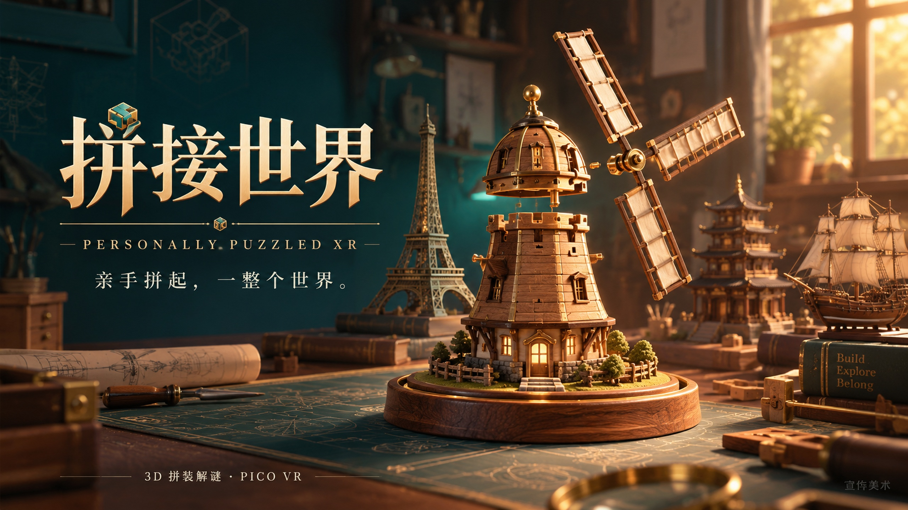
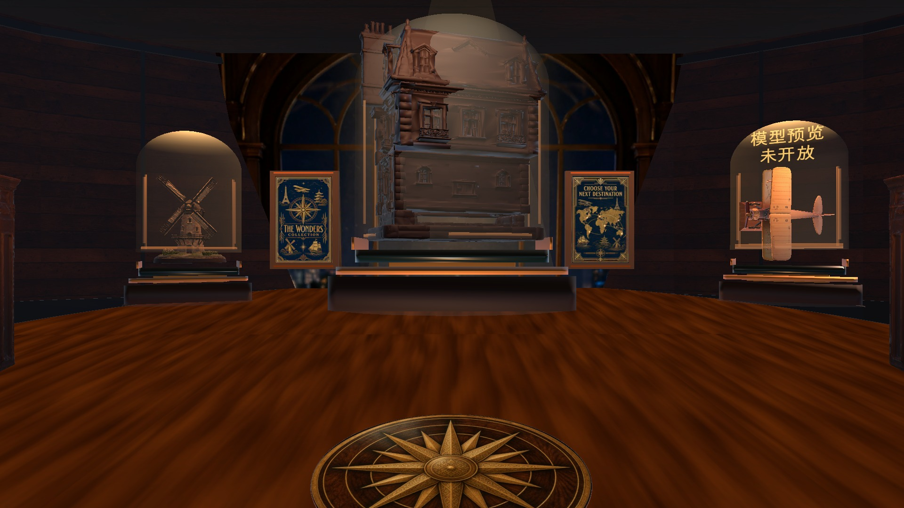
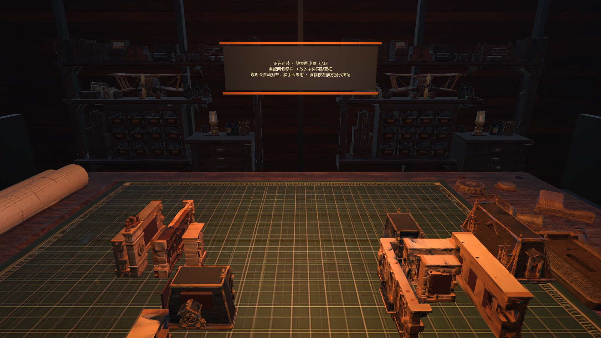
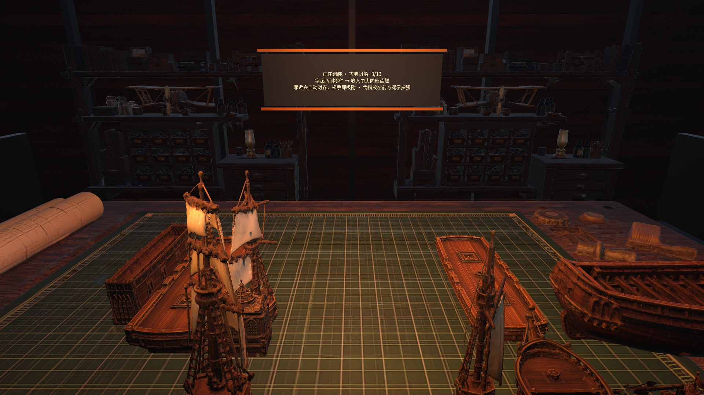
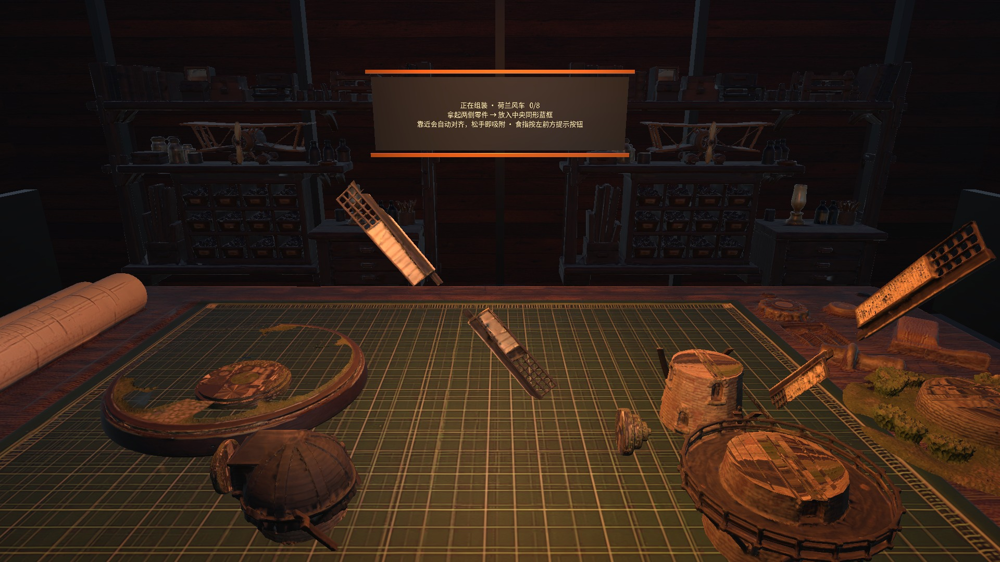
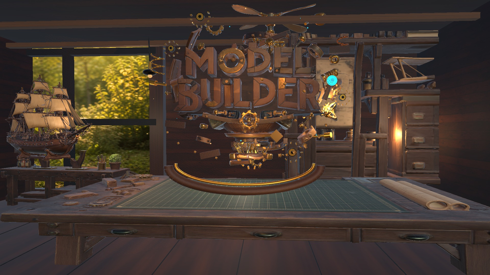

# 拼接世界 · Personally Puzzled XR

**挑选一个你喜爱的世界地标，将它亲手拼接成形。**



*宣传美术；实际游戏画面见下方截图与演示视频。*

在温暖的虚拟工坊里观察零件、调整方向、寻找连接，让散落的部件逐渐成为完整作品。项目面向 PICO VR，使用 Unity、URP 与 PICO OpenXR 开发。

[下载 PICO 体验版 APK](https://github.com/IdolMenendez/VRPuzzle/releases/download/showcase-20261014/PersonallyPuzzledVR-PICO-OptimizedV82.apk) · [查看 / 下载演示视频](https://github.com/IdolMenendez/VRPuzzle/releases/download/showcase-20261014/puzzle-world-gameplay-v80.mp4) · [全部下载与校验信息](https://github.com/IdolMenendez/VRPuzzle/releases/tag/showcase-20261014)

## 玩法

- **选择作品**：小屋、古典帆船、埃菲尔铁塔、宝塔和荷兰风车，五个主题共 53 个拼装部件。
- **观察与拼合**：拿起零件、旋转并对齐，在三维空间中逐步完成模型。
- **按需提示**：通过工坊内的提示控件查看拼装指引。
- **欣赏成果**：完成后查看组装出的作品。

## 游戏截图

以下来自当前 V82 场景的 Unity 运行画面，保留原始内容，按展示需要调整尺寸与编码。

| 选择你的下一件作品 | 小屋拼装 |
| --- | --- |
|  |  |
| **古典帆船** | **荷兰风车** |
|  |  |

## 演示视频与安装包

[](https://github.com/IdolMenendez/VRPuzzle/releases/download/showcase-20261014/puzzle-world-gameplay-v80.mp4)

**演示视频：约 4 分 30 秒。** 来自作者提供的 V80 作品演示，展示选关、抓取拼装与完成模型。上传版保留完整时长、音轨和原有画面标记，转为 720p H.264/AAC 以减小下载体积。它是历史版本的操作演示；上方截图与下方安装包对应 V82。

视频与 APK 放在 [GitHub Releases](https://github.com/IdolMenendez/VRPuzzle/releases/tag/showcase-20261014)，不进入源码历史。点击视频封面即可打开或下载 MP4，播放行为取决于浏览器。

| 文件 | 说明 |
| --- | --- |
| PICO APK | V82 资源优化体验版，230,554,388 字节（约 219.9 MiB），ARM64 |
| 游戏演示 MP4 | V80 操作演示，完整时长，720p |
| 宣传海报 JPG | 2560 × 1440，新版宣传美术 |
| SHA256SUMS.txt | 下载文件完整性校验值 |

安装包沿用已验证的构建产物，本次未重新编译。它使用开发测试签名，头显佩戴体验与持续性能验收仍待完成。

## 打开项目

需要 **Unity 6000.0.77f1** 与 **Git LFS**。先安装 Git LFS，再克隆仓库：

```bash
git lfs install
git clone https://github.com/IdolMenendez/VRPuzzle.git
cd VRPuzzle
git lfs pull
```

在 Unity Hub 中添加克隆后的仓库根目录。模型、纹理、字体和原生库通过 LFS 存储，单独下载 GitHub 源码 ZIP 可能无法得到完整资源。

当前 GitHub 主分支为 `main`，导入自已交付的 `dev` 快照。Build Settings 启用十个 V82 场景，以 Bootstrap 为入口。Garden Cottage 与 Windmill 设计研究保留为独立场景；Coastal Atelier 新场景方案不在此交付快照中。

## 开发与验证

| 内容 | 仓库入口 |
| --- | --- |
| 当前运行场景 | [V82 场景目录](Assets/Scenes/RuntimeV82_ResourceOptimization) |
| Unity 编辑器工具 | [LatestProjectTools.cs](Assets/Editor/LatestProjectTools.cs) |
| Android 工具链配置 | [CurrentAndroidToolchain.cs](Assets/Editor/CurrentAndroidToolchain.cs) |
| 包依赖 | [manifest.json](Packages/manifest.json) |
| 最近工作记录 | [CONTINUATION_STATE.md](Docs/CONTINUATION_STATE.md) |
| 验证记录索引 | [STAGE_VALIDATION_INDEX.md](Docs/STAGE_VALIDATION_INDEX.md) |
| GitHub 迁移校验 | [迁移验证记录](Artifacts/Checkpoints/183_GitHubDevMigration_20261014/VALIDATION.md) |
| 宣传素材说明 | [媒体来源与版本](Docs/Media/PROVENANCE.md) |

编辑器入口包括 `LatestProjectTools.Validate`、`LatestProjectTools.CaptureFinal`、`LatestProjectTools.RunInteractionSmoke` 和 `LatestProjectTools.BuildPico`。无人值守任务使用后台批处理；截图需要图形环境，交互测试由运行器自行退出。

Android 构建使用外部 SDK、JDK 17 和 NDK 27.2.12479018。工具链由上表的统一配置文件校验，目前保留原构建工作站的配置约束；在其他机器上构建前需适配该统一配置。Unity 缓存、构建目录和凭据不进入仓库。

## 项目信息

作品中文名：**拼接世界**；英文工程名：**Personally Puzzled XR**。创作工具：**Trae / Claude**。

项目沿用仓库的 [LICENSE](LICENSE)。第三方 SDK、模型与素材的许可请查看各自随附文件；仓库许可证不替代这些许可。
